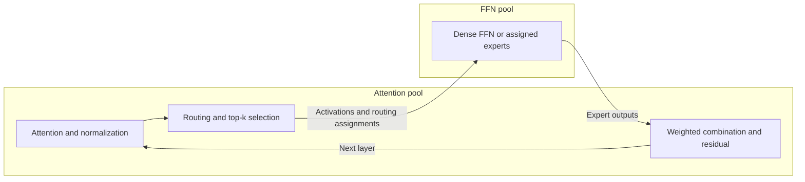

# Attention-FFN disaggregation (AFD)

Attention-FFN disaggregation (AFD) places attention (`A`) and feed-forward network (`F`) computation on independently configured execution domains.
For each decode layer and micro-batch, TokenSim schedules a directed acyclic graph (DAG) of attention kernels, cross-pool activation transfers, expert or dense FFN execution, collectives and output return.

## Placement and execution protocols

| Pool | Responsibilities |
| --- | --- |
| `A` (`af_attention`) | Request ownership, KV cache residency, attention projections and cores, normalization, residual state and token sampling |
| `F` (`af_ffn`) | Dense FFNs, shared experts and routed MoE experts across TP/DP/PP/EP ranks |
| Prefill workers | Complete-model prefill before KV handoff into the AF decode pool |



- **`partial_return` (default)**: supports `router_location` on `"a"` or `"f"`, pools compatible ready `F` micro-batches across `A` owners within `ffn_batch_wait_us` (default 5 us for multi-A) up to `ffn_batch_max_tokens`, and performs weighted expert combination on `A`.
- **`vllm_afd`**: places routing and weighted combination on `F` (TP=PP=EP=1, one `F` replica, BF16 weights, all-MoE layers without shared experts), returning one combined hidden vector per token and synchronizing configured `A` peers per round.
- **`colocated_dense_reuse`**: when `A` and `F` share physical ranks on an AF link, eligible dense layers reuse local activations and residuals without cross-endpoint copies while retaining TP reductions.
- **Custom block layouts**: models can declare `attention_windows`, `attention_geometries` (`head_dim`, `num_key_value_heads`, `k_eq_v`) and `block_layout` (`attention_output_norm`, `ffn_output_norm`, `value_norm`, `embedding_scale`, `layer_scale`, `logit_softcap`), plus per-domain `parallel.pipeline_layer_counts`.

## Communication, memory and variability

| Setting inside `af` | Purpose |
| --- | --- |
| `enabled`, `execution_domains` | Enable AFD decode and configure `A`/`F` worker groups and TP/DP/PP/EP layouts (`logical_instances` auto-derive when omitted) |
| `execution_protocol`, `router_location` | Select `partial_return` or `vllm_afd`, and `a` or `f` routing |
| `af_block_size` | Maximum query tokens per `A` micro-batch |
| `ffn_batching`, `ffn_batch_wait_us`, `ffn_batch_max_tokens` | Cross-owner `F` batching controls |
| `max_inflight_blocks`, `max_inflight_scope` | Concurrent micro-batch credit limit per `iteration` or `owner` |
| `transfer_topology_mode` | `physical` (node local + inter-node TX/RX budgets via `communication_domains`) or `flat_link` (catalog fabric/endpoint lanes) |
| `links` | Endpoint pairs, resource groups and directional wire dtypes (`a_to_f_dtype`, `f_to_a_dtype`) |
| `communication_timing` | Separated host submission, control and completion overheads; optional calibrated profiles |
| `jitter_model`, `peer_layer_barrier`, `transport_effects` | Optional seeded compute/network lognormal perturbations, peer layer barriers and packet-tail / finite-receive-slot modeling |

In `flat_link` mode, `communication_plan[*].algorithm` supports `ring` (default), `tree`, `direct` and `auto`.
A worker group's `hardware` field accepts either a single device ID or a per-worker list of `num_workers` device IDs for heterogeneous placement; same-device `A`/`F` pairs incur zero wire transfer time.

Physical admission enforces on every device $r$:

$$
M_{\mathrm{weights},r} + M_{\mathrm{workspace},r} + M_{\mathrm{KV},r} \leq u_r M_{\mathrm{device},r},
$$

where $u_r$ is `gpu_memory_utilization`.
Distinct weight, activation, KV and directional wire precisions determine storage budgets, compute dtypes and sender/receiver cast operations together.

```bash
tokensim \
  --cluster data/clusters/af/decode_half_duplex.json \
  --model llama-3-8b \
  --latency_backend operator_table \
  --latency_fallback analytical_only \
  --batching paged-attn \
  --block_size 16 \
  --distribution burst \
  --request_count 2 \
  --prefill_mean_len 16 \
  --prefill_range_len 0 \
  --decode_mean_len 4 \
  --decode_range_len 0 \
  --verbose none \
  --results_path outputs/afd-example
```

Results include `af_runtime_state`, `af_trace`, `af_operator_stats`, `af_latency_providers` and `af_phase_fidelity`.
Pass `--trace_mode full` to export per-layer timelines (see [Tracing and profiler comparison](../reference/operator-tracing.md)).

## DeepSeek-V4 compressed attention in AFD

With `deepseek-v4-pro`, `A` owns compressed/sliding attention (CSA/HCA), the indexer, compressors, hyper-residual (`mHC`) pre/post sites, normalization, embedding and vocabulary output, while `F` owns shared and routed expert shards priced from exact routed token histograms and packed weights.
Grouped KV admission reserves full, sliding, indexer and compressor-state slots across `A` TP ranks, and a positive `af.max_inflight_blocks` bounds active residual and dispatch workspace memory.
Measured `dsv4_attention` and `mhc` module tables compose directly with analytical `routed_experts` and `hc_head` stages.
